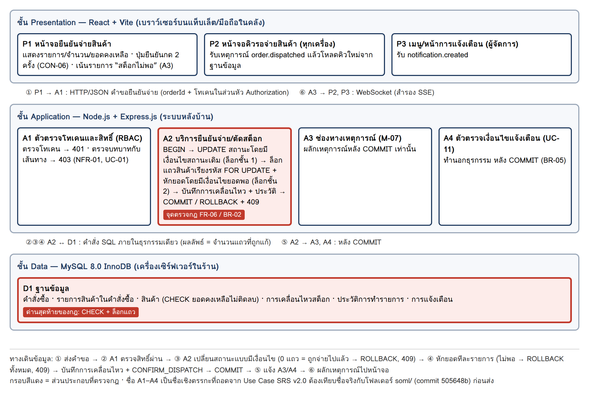

# ใบงานครั้งที่ 1 ส่วน B · วางแผนก่อนทดสอบ · ทีม Ti

> เฉพาะส่วน B (งานกลุ่ม) · ส่วน A ส่งทาง Google Form ของแต่ละคน · ช่องรหัสนักศึกษาเว้นไว้เพราะ repo เป็น Public
> คำตอบขั้นที่ 1–6 คัดจากใบงานของทีมที่ทำเมื่อ 30 ก.ย. 2569 (`S1-B_ชื่อทีม.docx`) โดยไม่แก้เนื้อหา
> ส่วนที่มีป้าย **[เพิ่ม 23 ต.ค. 2569]** คือช่องที่เว้นว่างไว้ในใบงานเดิม ทีมเติมภายหลังจากการเปิดโค้ดจริง

| รายการ | ข้อมูล |
|---|---|
| ชื่อทีม | Ti |
| ชื่อโครงงาน | อำพร OMS — ระบบจัดการคำสั่งซื้อและตรวจสอบคลังสินค้า ร้านวัสดุก่อสร้างอำพรคอนกรีต |
| เอกสารที่ใช้ | Use Case SRS v2.0 (20/09/2569, Review Candidate) · โค้ด `soml/` ใน repo โครงงาน [TriratWongsit/soml-pos-inventory](https://github.com/TriratWongsit/soml-pos-inventory) |

## ขั้นที่ 1 feature และกฎที่สำคัญที่สุด (2 คะแนน)

| หัวข้อ | คำตอบของทีม |
|---|---|
| feature | UC-07 ยืนยันจ่ายสินค้าและตัดสต็อก (FR-05, FR-06) |
| กฎที่สำคัญที่สุด | FR-06 / BR-02: การจ่ายสินค้าและการตัดสต็อกต้องเป็นธุรกรรมเดียว สำเร็จทั้งหมดหรือไม่เกิดเลย คำสั่งซื้อหนึ่งใบจ่ายได้ครั้งเดียว และยอดคงเหลือต้องไม่ติดลบ |
| พบกฎนี้ที่ไหน | เอกสาร: Use Case SRS v2.0 หัวข้อ 4.7 (UC-07), 5.5 BR-02, 2.5 CON-05, Appendix B.1/B.4, AC-07, AC-08 · ไฟล์โค้ด **[เพิ่ม 23 ต.ค. 2569]** `soml/backend/modules/stock-deduction/index.js` (ธุรกรรมตัดสต็อก) · `soml/backend/modules/dispatch/index.js` (รับคำขอ แปลงผลเป็น 404/409) · `soml/backend/app.js` บรรทัด 52 (เส้นทาง `POST /api/orders/:id/dispatch`) |
| ทำไมเลือกข้อนี้ | SRS ระบุว่าเป็น “ความสามารถที่สำคัญที่สุดของระบบ” (Critical) ตอบวัตถุประสงค์ 1.2.3 และแก้ปัญหาจริงหน้างาน EV-06 (บิลเก่าใช้รับของซ้ำ) กับ EV-07 (สต็อกไม่ตรง) ถ้าพังจะเสียของจริงและตัวเลขสต็อกผิดโดยไม่มีใครรู้ อีกทั้งเป็นกฎเรื่องการทำงานพร้อมกัน ซึ่งทดสอบผ่านหน้าจอธรรมดาไม่เจอ |

## ขั้นที่ 2 ส่วนประกอบที่ feature นี้ผ่าน (3 คะแนน)

**ที่มาของภาพ: สร้างย้อนหลัง** วาดเมื่อ 30/09/2569 จาก Use Case SRS v2.0 (หัวข้อ 2.4, 2.5, 3.3, 3.4, 4.7) ซึ่งสะท้อนระบบ ณ git commit 505648b ระบบพัฒนาเสร็จก่อนวาดภาพนี้

**[เพิ่ม 23 ต.ค. 2569]** เทียบชื่อเชิงตรรกะกับโค้ดจริง: A1 = `verifyToken` + `requireRole` ใน `backend/app.js` · A2 = `backend/modules/dispatch` เรียก `backend/modules/stock-deduction` ในธุรกรรมเดียว (`withTransaction`) · A3 = `backend/modules/queue` · A4 = `backend/modules/alert` · D1 = MySQL ตาม `db/schema/schema.sql`

## ขั้นที่ 3 สามคำถาม (6 คะแนน)

| คำถาม | คำตอบและเหตุผล |
|---|---|
| 1 ใครรับผิดชอบ | A2 บริการยืนยันจ่าย/ตัดสต็อก ฝั่งเซิร์ฟเวอร์เป็นเจ้าของกฎ: ใส่เงื่อนไขสถานะเดิมในคำสั่ง UPDATE เดียวกัน (ล็อกชั้นที่ 1) และล็อกแถวสินค้าเรียงตามรหัสแล้วหักยอดโดยมีเงื่อนไขว่ายอดพอ (ล็อกชั้นที่ 2) ทั้งหมดในธุรกรรมเดียว (UC-07 ขั้น 4–6) โดยมี D1 MySQL InnoDB เป็นด่านสุดท้ายด้วยข้อจำกัด CHECK ยอดไม่ติดลบ (3.3, 5.2) ส่วนหน้าจอ P1 แค่ยืนยันซ้ำและเตือน “สต็อกไม่พอ” ไม่ได้บังคับกฎ (A3 ระบุว่ายังกดได้แต่ถูกปฏิเสธ) และ A1 ตรวจเพียงบทบาท |
| 2 ข้อมูลส่งถึงครบไหม | ครบสำหรับกฎนี้ เพราะหน้าจอส่งแค่เลขคำสั่งซื้อกับโทเคน แล้วเซิร์ฟเวอร์อ่านรายการสินค้า จำนวน และยอดคงเหลือจากฐานข้อมูลเองภายในธุรกรรม ไม่เชื่อค่าจากหน้าจอ ผู้จ่ายได้จากโทเคน ไอพีได้จากคำขอ จึงบันทึกผู้จ่าย เวลา และ CONFIRM_DISPATCH ได้ (Postconditions 4.7) ผลกลับมีรหัส 409 แยกข้อความ “ถูกจ่ายไปแล้ว” กับ “สต็อกไม่พอ” และ 404 ได้ ข้อสังเกต: SRS ไม่ได้ระบุว่า 409 กรณีสต็อกไม่พอบอกด้วยหรือไม่ว่าสินค้ารายการใดไม่พอ ต้องเทียบกับโค้ด |
| 3 ถ้าพัง จะรู้ได้ไหม | ธุรกรรมหลัก: รู้ — กรณีจ่ายซ้ำ/สต็อกไม่พอ ระบบ ROLLBACK และตอบ 409 ให้ผู้ใช้เห็นทันที ทุกการตัดสต็อกมีบันทึกการเคลื่อนไหวพร้อมยอดหลังเปลี่ยน (M-06) และประวัติ CONFIRM_DISPATCH ตรวจย้อนหลังได้ใน UC-10 ส่วนหลัง COMMIT: รู้ไม่ครบ — ถ้าผลักเหตุการณ์ order.dispatched ไม่ถึง หน้าจอคิวกู้คืนเองเมื่อเชื่อมต่อใหม่ (UC-05 E1) แต่ถ้าสร้างการแจ้งเตือนสินค้าใกล้หมดล้มเหลว UC-11 เขียนว่า “การแจ้งเตือนอาจขาดหนึ่งรอบ” โดยไม่ระบุว่ามีการบันทึกข้อผิดพลาดหรือแจ้งใคร จึงอาจพังเงียบ ๆ |

## ขั้นที่ 4 ข้อค้นพบ 1 ข้อ ครบ 4 ส่วน (4 คะแนน)

| ส่วน | ข้อความ |
|---|---|
| 1 เอกสารเขียนว่าอะไร อยู่ตรงไหน | Use Case SRS v2.0 หัวข้อ 5.5 BR-02 เขียนว่า “การจ่ายสินค้าและการตัดสต็อกต้องเป็นธุรกรรมเดียวกัน และเจ้าของงานคือพนักงานคลังเท่านั้น (UC-07)” |
| 2 ขัดกับข้อใด | ขัดกับหัวข้อ 4.7 UC-07 Primary Actor “พนักงานคลังสินค้า (ผู้จัดการทำแทนได้)” และหัวข้อ 2.3 ที่ให้ผู้จัดการ “ทำได้ทุกอย่างของสองบทบาทแรก” — เอกสารฉบับเดียวกันบอกสองแบบว่าผู้จัดการยืนยันจ่ายสินค้าได้หรือไม่ |
| 3 ผลต่อการทดสอบ | เขียนผลที่คาดหวังของกรณีทดสอบ “ผู้จัดการยืนยันจ่ายสินค้า” ไม่ได้ (ต้องสำเร็จ หรือต้องได้ 403?) ผู้ทดสอบสองคนอาจตัดสินต่างกัน และ AC-07/AC-08 ไม่ได้ระบุบทบาทไว้เลย นอกจากนี้ไม่มี AC ใดตรวจว่าพนักงานขายเรียกเส้นทางยืนยันจ่ายโดยตรงแล้วถูกปฏิเสธ (AC-01 ตรวจแค่เส้นทางของผู้จัดการ) ช่องโหว่ด้านสิทธิ์ของกฎที่สำคัญที่สุดจึงอาจหลุดการทดสอบ |
| 4 ข้อเสนอ | ให้ทีมตัดสินกับเจ้าของร้านว่าผู้จัดการจ่ายได้หรือไม่ แล้วแก้ BR-02 ใน 5.5 ให้ตรงกับ UC-07 และ 2.3 (เช่น “เจ้าของงานคือพนักงานคลัง ผู้จัดการทำแทนได้”) จากนั้นเทียบกับไฟล์ประกาศเส้นทางและบทบาทในโค้ด และเพิ่ม AC: “Given พนักงานขาย When เรียกเส้นทางยืนยันจ่ายโดยตรง Then 403 สต็อกและสถานะไม่เปลี่ยน” กับ “Given ผู้จัดการ When ยืนยันจ่าย Then [ผลตามที่ตกลง]” |

**[เพิ่ม 23 ต.ค. 2569] ตำแหน่งโค้ดที่เทียบแล้ว:** `soml/backend/app.js` บรรทัด 52 ประกาศ `requireRole('warehouse', 'manager')` แปลว่าโค้ดให้ผู้จัดการจ่ายได้ ตรงกับ UC-07 และ 2.3 แต่ไม่ตรงกับถ้อยคำ BR-02 ข้อค้นพบนี้จึงยังเปิดอยู่ที่ตัวเอกสาร ส่วนกรณีพนักงานขาย มีชุดทดสอบ `dispatch.test.js` ข้อ “พนักงานขายทำไม่ได้ (403)” และทีมนำไปเป็นกรณีทดสอบ DSP-06 ในใบงานครั้งที่ 2

## ขั้นที่ 5 Entry 2 ข้อ และ Exit 2 ข้อ (4 คะแนน)

| ประเภท | เกณฑ์ของทีม |
|---|---|
| Entry 1 | ระบบ ณ commit 505648b ติดตั้งบนเครื่องทดสอบกับ MySQL 8.0 InnoDB แล้ว ตรวจพบข้อจำกัด CHECK ยอดคงเหลือไม่ติดลบในตารางสินค้า และชุดทดสอบอัตโนมัติเดิมผ่าน 130/130 ข้อ |
| Entry 2 | มีข้อมูลทดสอบพร้อม: บัญชีเปิดใช้งานครบ 3 บทบาท (เข้าสู่ระบบได้ตาม AC-12), คำสั่งซื้อสถานะรอจ่ายสินค้าอย่างน้อย 20 ใบ ในจำนวนนี้มี 1 ใบที่มีสินค้า 2 รายการซึ่งรายการที่สองยอดไม่พอ และบันทึกยอดคงเหลือตั้งต้นของทุกสินค้าไว้เป็นค่าอ้างอิง |
| Exit 1 | AC-07 และ AC-08 ผ่าน 100%: ยิงคำขอยืนยันจ่ายพร้อมกัน 2 คำขอต่อคำสั่งซื้อเดียว ซ้ำ 20 รอบ ทุกรอบสำเร็จ 1 คำขอ อีกคำขอได้ 409 และมีบันทึกการเคลื่อนไหว 1 แถวต่อสินค้า 1 รายการ · กรณีสต็อกไม่พอ สถานะและยอดทุกรายการเท่าค่าเดิม 0 แถวเคลื่อนไหว |
| Exit 2 | หลังจ่ายครบ 20 ใบ ยอดคงเหลือในระบบ = ยอดตั้งต้น − ผลรวมจำนวนที่จ่าย ตรงกัน 100% ทุกสินค้า ไม่มียอดติดลบ และไม่มีข้อบกพร่องระดับสูง/วิกฤตของ UC-07 ค้างอยู่ (รวมข้อค้นพบขั้นที่ 4 ได้ข้อสรุปและทดสอบซ้ำแล้ว) |

## ขั้นที่ 6 หน้าที่ของสมาชิกและการใช้ AI (1 คะแนน)

| ชื่อ–สกุล | รหัส | ทำส่วนใด |
|---|---|---|
| ตรัยรัตน์ วงษ์สิทธิ์ | (เว้นไว้) | ผู้ทำหลักขั้นที่ 1–6 |
| พนาวุฒน์ อภิปสันติ | (เว้นไว้) | ผู้ตรวจ |
| ทวีชัย ทิใจ | (เว้นไว้) | ผู้ส่งหลัก จัดใบงานเข้า repo และตรวจว่าไม่มีรหัสนักศึกษา |

> หมายเหตุ: ใบงานเดิมมีชื่อสมาชิก 2 คนและเว้นช่อง “ทำส่วนใด” ไว้ การแบ่งงานในตารางนี้ทีมกรอกเมื่อ 23 ต.ค. 2569 ให้ตรงกับ [TEAM.md](../TEAM.md)

| ใช้ AI หรือไม่ เพื่ออะไร | ตรวจกับโค้ดหรือเอกสารใด |
|---|---|
| ใช้ Claude ช่วยอ่าน Use Case SRS v2.0 เลือก feature ร่างแผนภาพส่วนประกอบ และร่างคำตอบขั้นที่ 3–5 แล้วทีมแก้ให้ตรงกับที่ทำจริง · 23 ต.ค. ใช้ Claude จัดใบงานเป็นไฟล์นี้และเปิดโค้ดหาตำแหน่งที่เว้นไว้ (ดู [AI-LOG.md](../AI-LOG.md)) | Use Case SRS v2.0 หัวข้อ 2.3, 3.3–3.4, 4.7, 5.2, 5.5, Appendix B, D · โค้ด `soml/backend/app.js`, `modules/dispatch`, `modules/stock-deduction` |
